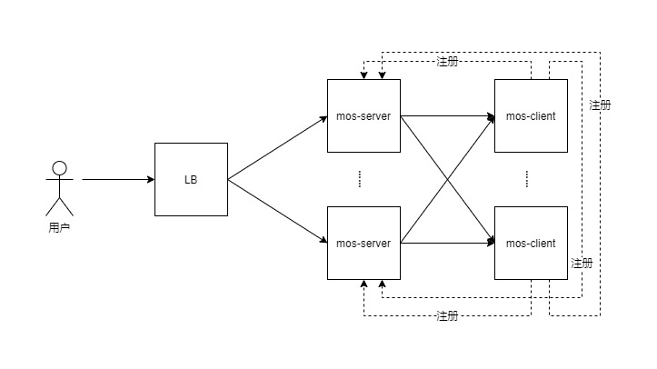

<div align="center">

# MOS · Martin Object Storage

**Java 编写的分布式对象存储服务**

[](https://openjdk.org/)
[](https://spring.io/projects/spring-boot)
[](LICENSE)
[](https://www.npmjs.com/package/@668mt/mos-cli)

[English](#) | 简体中文

</div>

---

## 这是什么

MOS 是一套**服务端 + 存储节点**分离的分布式对象存储实现。服务端只管元数据与鉴权，真正的字节流落在自建的存储节点上，节点之间通过心跳注册、权重调度，支持多副本。

| | |
|---|---|
| **服务端** `mos-server` | 元数据、鉴权、签名、调度、后台管理界面 |
| **存储节点** `mos-client` | 实际存文件，横向扩展，无中心化瓶颈 |
| **Java SDK** `mos-sdk` | 应用集成用，签名与 URL 构造与 CLI 完全一致 |
| **命令行** `mos-cli` | TypeScript 实现，发布到 npm，脚本化利器 |

## 下载

预编译发行包见 [GitHub Releases](https://github.com/668mt/mos/releases)：

| 版本 | 说明 |
|---|---|
| [2.1.1](https://github.com/668mt/mos/releases/tag/2.1.1) | 最新发行版，含审计信息、跨桶复制、文件夹合并 |
| [v2.1](https://github.com/668mt/mos/releases/tag/v2.1) | 新增自动生成缩略图 |

> 3.0 分支尚未发布发行包，请从源码构建（见下方「快速开始」）。

## 特性

- **分片上传 / 断点续传 / 秒传** —— 分片大小自适应，秒传命中零流量，续传只补缺失分片
- **签名访问** —— 带时效的签名 URL，支持公开/私有与桶级授权
- **多副本与分布式** —— 存储节点自动注册，按权重调度，文件可配置副本数
- **多种客户端** —— Java SDK、Spring Boot Starter、命令行工具（npm）、命令行上传工具
- **在线处理** —— 图片/视频缩略图、m3u8 分片重签名、图集、Markdown/TXT 渲染
- **短链接** —— `POST /s` 生成短码，访问时 302 跳转到带签名的直链
- **内网重定向** —— 同一内网访问自动跳到内网地址，节省公网带宽（可选）
- **权限体系** —— 用户、桶、桶授权（SELECT/INSERT/UPDATE/DELETE）、开放平台 key
- **运维能力** —— 回收站、访问统计、Prometheus 指标、OpenAPI 文档

## 架构



```
   ┌──────────┐   签名/上传/下载   ┌──────────────┐   调度/读写指令   ┌────────────┐
   │  客户端   │ ───────────────▶ │  mos-server  │ ───────────────▶ │ mos-client │
   │ SDK/CLI/ │                  │  元数据+鉴权  │                  │  存储节点1  │
   │  Web UI  │ ◀─────────────── │  MySQL+Redis │ ◀─────────────── │ mos-client │
   └──────────┘    字节流代理     └──────────────┘   心跳/上报       │  存储节点2  │
                                                                   └────────────┘
```

## 模块

| 模块 | 说明 |
|---|---|
| `mos-dependency-parent` | 依赖与构建父 POM，统一 Java 版本与依赖版本 |
| `mos-base` | 公共工具：加解密、流封装、IP、文件分片、加权随机 |
| `mos-sdk` | Java 客户端 SDK，`MosSdk` 主入口 |
| `mos-sdk-spring-boot-starter` | Spring Boot 自动装配，`mos.config.*` 一键配置 |
| `mos-server` | 服务端：元数据、鉴权、调度、开放接口、管理后台 |
| `mos-client` | 存储节点：本地磁盘存储、分片合并、文件服务 |
| `mos-plugin-utils` | 独立命令行上传工具（`mos.yaml` 配置） |
| `assembly` | 打包：server.zip / client.zip / sdk / sqls |
| `mos-cli` | TypeScript 命令行工具（npm 包 `@668mt/mos-cli`） |

## 环境要求

| 组件 | 版本 | 是否必需 |
|---|---|---|
| JDK | **17+** | 必需 |
| MySQL | 8+ | 必需 |
| Redis | 5+ | 必需 |
| FFmpeg | 任意 | 可选，用于视频缩略图与时长探测 |
| Node.js | 18+ | 可选，仅使用 `mos-cli` 时需要 |

> **注意**：3.0 分支基于 Spring Boot 3.0.2，编译目标为 Java 17。早期版本（2.x）使用 JDK 8，请勿混用。

## 快速开始

### 1. 准备数据库

`assembly/sqls/` 下是**增量升级**脚本（全部为 `alter table`），仓库中不含基线建表脚本。两种方式：

**方式 A：让代码生成器建表（推荐）**

服务端已内置 `mt-spring-generator-starter`，默认开启，会按实体类的 `@Table` / `@Index` 注解自动建表与升级：

```properties
mt.config.generator.enabled=true
mt.config.generator.packages=mt.spring.mos.server.entity.po
```

建好库 `mos` 后直接启动服务端即可。

**方式 B：从 2.1.x 升级**

若已有 2.1.x 的库，按版本顺序依次执行增量脚本：

```bash
for f in assembly/sqls/mos_ddl-2.1.0-RELEASE.sql \
         assembly/sqls/mos_ddl-2.1.1-RELEASE.sql \
         assembly/sqls/mos_ddl-2.1.2-RELEASE.sql; do
  mysql -uroot -p mos < "$f"
done
```

> 全新部署没有基线脚本，请用方式 A，或参考 `mos_ddl-1.2-RELEASE.sql` 等早期脚本自行补齐基线表结构。

### 2. 构建

```bash
mvn clean package -DskipTests -pl assembly -am
```

产物在 `assembly/target/mos-3.0/`：

```
mos-3.0/
├── server.zip                  # 服务端（含 fat jar、application.properties、启停脚本）
├── client.zip                  # 存储节点
├── mos-plugin-utils-3.0.zip    # 命令行上传工具
├── sdk/                        # mos-base / mos-sdk / mos-sdk-spring-boot-starter 的 jar
└── sqls/                       # 数据库脚本
```

### 3. 配置

**服务端** `server/application.properties`：

```properties
# 数据源
spring.datasource.driver-class-name=com.mysql.cj.jdbc.Driver
spring.datasource.url=jdbc:mysql://localhost:3306/mos?characterEncoding=UTF-8&useSSL=false
spring.datasource.username=root
spring.datasource.password=root

# Redis
spring.data.redis.host=localhost
spring.data.redis.password=123456

# 管理员账号
mos.server.admin-username=admin
mos.server.admin-password=admin

# 默认桶名
mos.server.default-bucket-name=default
```

**存储节点** `client/application.properties`：

```properties
# 存储目录，多个用逗号分隔，可带 (权重) 后缀
mos.client.base-paths=/data/mos(100),/data/mos-ssd(0)

# 服务端地址
mos.client.server-hosts=http://localhost:9700
```

### 4. 启动

```bash
# 先启存储节点，再启服务端（节点会向服务端注册心跳）
cd client && ./start.sh      # Windows: start.bat
cd ../server && ./start.sh
```

访问 `http://localhost:9700`，用管理员账号登录。

- 后台管理：<http://localhost:9700/>
- OpenAPI 文档：<http://localhost:9700/doc.html>
- 监控指标：<http://localhost:9701/actuator/prometheus>

## Java SDK

```xml
<dependency>
    <groupId>com.github.668mt.mos</groupId>
    <artifactId>mos-sdk</artifactId>
    <version>2.1.2</version>
</dependency>
```

> Maven Central 上当前最新发布版本为 **2.1.2**（`com.github.668mt.mos:mos-sdk`）。3.0 尚未发布，可先用 2.1.2 或自行 `mvn install` 本地构建。

```java
MosConfig config = new MosConfig("http://localhost:9700", "default", secretKey, openId);
MosSdk sdk = new MosSdk(config);

// 上传（覆盖同名文件，设为公开）
sdk.uploadFile(new File("a.txt"), new UploadInfo("/docs/a.txt", true, true, null));

// 下载
sdk.downloadFile("/docs/a.txt", new File("./a.txt"));

// 列举目录
PageInfo<DirAndResource> page = sdk.list("/docs", null, 1, 20);

sdk.shutdown();
```

多个服务端地址时用 `new MosConfig(List<String> hosts, ...)`，SDK 会按权重与健康检查自动选择。

### Spring Boot Starter

```xml
<dependency>
    <groupId>com.github.668mt.mos</groupId>
    <artifactId>mos-sdk-spring-boot-starter</artifactId>
    <version>2.1.2</version>
</dependency>
```

```properties
mos.config.hosts=http://localhost:9700
mos.config.bucket-name=default
mos.config.open-id=1
mos.config.secret-key=xxxxx
```

```java
@Autowired
private MosSdk sdk;
```

## 命令行工具

```bash
npm install -g @668mt/mos-cli

mos config set --host http://localhost:9700 --bucket default --secret-key <秘钥>
mos upload ./dist -r /dist
mos download /docs/a.txt -o ./a.txt
```

支持分片并发、秒传、断点续传、递归目录、多地址故障转移。完整说明见 **[mos-cli/README.md](mos-cli/README.md)**。

## 开放接口

服务端 `controller/open` 下提供免登录开放接口，配合 `openId` + `secretKey` 签名使用：

| 接口 | 说明 |
|---|---|
| `POST /upload/{bucket}/init` | 上传初始化，返回秒传命中与已上传分片索引 |
| `POST /upload/{bucket}` | 上传单个分片 |
| `POST /upload/mergeFiles` | 合并分片并登记资源 |
| `GET /open/resource/{bucket}/list` | 分页列举目录 |
| `GET /open/resource/{bucket}/info` | 查询文件信息（含 md5） |
| `DELETE /open/resource/{bucket}/deleteFile` | 删除文件 |
| `PUT /open/resource/{bucket}/rename` | 重命名 |
| `GET /open/resource/{bucket}/isExists` | 判断是否存在 |
| `DELETE /open/dir/{bucket}/deleteDir` | 删除目录 |
| `GET /mos/{bucket}/**` | 公开资源访问（支持 `?thumb` `?render` `?gallery`） |
| `POST /s` | 创建短链接 |
| `GET /s/{shortCode}` | 短链接 302 跳转 |

## 配置项速查

### 服务端 `mos.server.*`

| 配置项 | 默认值 | 说明 |
|---|---|---|
| `admin-username` / `admin-password` | `admin` | 管理员账号 |
| `default-bucket-name` | `default` | 默认桶名 |
| `min-avaliable-space-g-b` | `4` | 剩余空间低于此值（GB）停止接收上传 |
| `regist-pwd` | 空 | 存储节点注册密码 |
| `client-strategy` | `priority_weight` | 节点选择策略（`weight` / `priority_weight`） |
| `current-ip` | 自动探测 | 内网重定向使用的本机 IP |
| `ip-prefix` | 空 | 自动探测 IP 时的网段前缀，如 `192.168.0` |
| `lan-redirect.enabled` | `false` | 是否启用内网重定向 |
| `redis-prefix` | `mos-server` | Redis key 前缀 |
| `cors-config.allowed-origins` | `*` | 跨域白名单 |

> 回收站保留期固定为 **15 天**（`TrashCron` 每日 03:00 清理），暂不可配置。
>
> 文件副本数（`dataFragmentsAmount`）是**桶级**属性，在后台创建/编辑桶时设置，不是服务端全局配置。

### 存储节点 `mos.client.*`

| 配置项 | 默认值 | 说明 |
|---|---|---|
| `base-paths` | **必填** | 存储目录，逗号分隔，可带 `(权重)`（缺省权重 1） |
| `server-hosts` | `http://localhost:9700` | 服务端地址，逗号分隔可配多个 |
| `instance.ip` | 自动探测 | 节点 IP（多网卡环境建议显式配置） |
| `instance.ip-prefix` | 空 | 自动探测 IP 时的网段前缀 |
| `instance.port` | `9800` | 节点端口 |
| `instance.weight` | — | 调度权重 |
| `min-avaliable-space-g-b` | `2` | 预留空间（GB），低于此值的路径不接收上传 |
| `merge-thread-pool-core` | `4` | 分片合并线程数 |
| `base-path-strategy-name` | `weight` | 存储目录选择策略 |
| `enable-auto-import` | `false` | 自动导入开关（**当前实现已注释，暂不可用**） |
| `health-check-file` | 空 | 健康检查哨兵文件，每个磁盘根目录检查其是否存在 |

## 开发

```bash
# 编译（按 AGENTS.md 建议只编译改动的模块）
cd mos-server && mvn -q -DskipTests compile

# 全量打包
mvn clean package -DskipTests -pl assembly -am

# mos-cli
cd mos-cli && npm install && npm test
```

## 许可

[Apache License 2.0](LICENSE)

## 更新日志

见 [CHANGELOG.md](CHANGELOG.md)，含各版本差异与数据库升级指引。

## 致谢

- [mt-spring 系列](https://github.com/668mt) —— 基础 Starter、Web 组件、代码生成器
- [FFmpeg](https://ffmpeg.org/) —— 视频缩略图与时长探测
